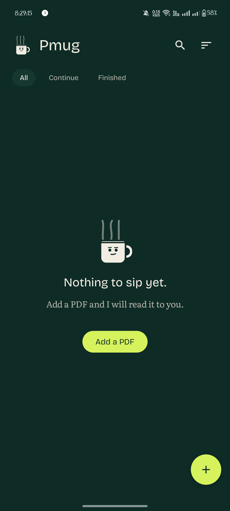
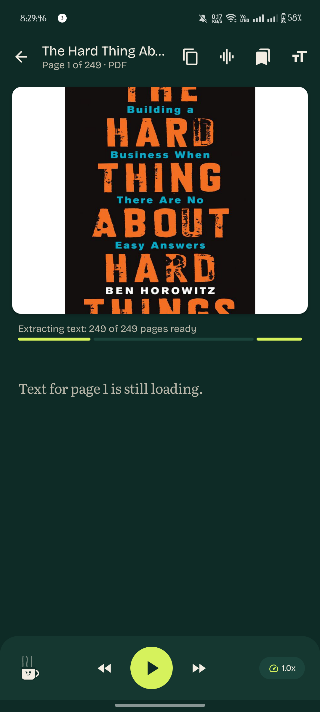
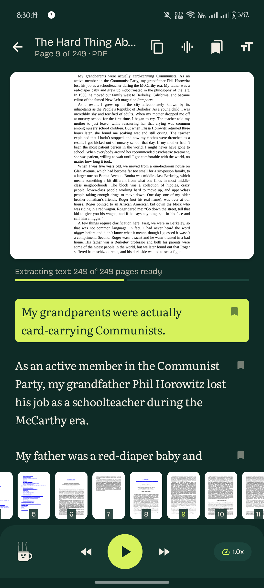
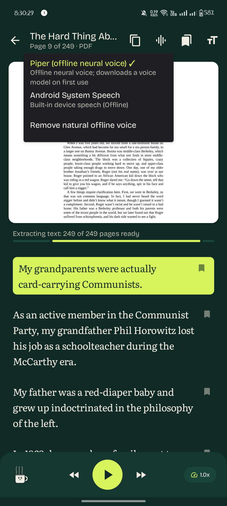
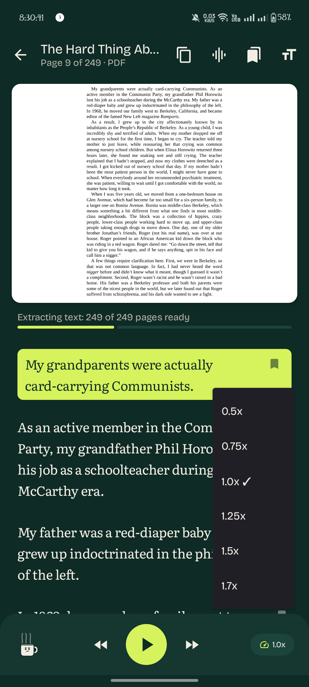
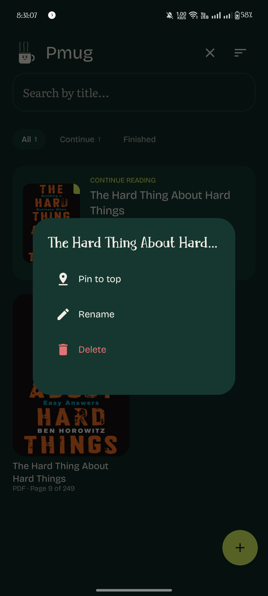

# Pmug

**A reading partner for papers, books, and the pages you mean to get through.**

Pmug is an Android reader that pairs a calm reading experience with spoken text. Follow along as sentences are highlighted, or read at your own pace and pick up where you left off. It supports PDFs, plain text, Markdown, and DOCX, with offline text-to-speech options.

## Screenshots

| Your library | Read and listen | Choose a voice |
|:--:|:--:|:--:|
|  |  |  |

| Full-screen page view | Reading companion | More of Pmug |
|:--:|:--:|:--:|
|  |  |  |

## Why I built it

I wanted a reading partner: something that could sit alongside me, help me keep going, and make dense material easier to follow. I often struggled to read more than three pages continuously. Pmug grew from that experience.

While speech reads a sentence, Pmug highlights it so your eyes can follow along. The goal is speech that feels more open and natural than a rapid stream of text, with a focused layout that keeps attention on the page. I also want the app to stay small enough to be practical on a wide range of Android devices.

## What it can do

- **Read and listen together:** Follow spoken sentences with synchronized highlighting.
- **Offline speech:** Use Piper neural voices, with Android system text-to-speech as a fallback.
- **Choose a voice:** Browse, preview, download, and manage Piper voices.
- **Read multiple formats:** Import PDF, TXT, Markdown, and DOCX documents.
- **Keep your place:** Resume reading, save bookmarks, and track progress.
- **Study PDF pages:** Select and copy extracted text, jump to a page, and zoom into figures in the full-screen viewer.
- **Stay organized:** Search your library and browse Continue, All, and Finished shelves.
- **Read comfortably:** Use bionic typography and a clean, distraction-free reader.

Text extraction and speech processing are designed to work on-device. Image-only or scanned PDFs can still be viewed, but require OCR before their text can be read aloud.

## The idea for Pmug

Pmug's mascot is meant to feel like a companion, not decoration. The longer-term vision is for it to respond to the reader's effort and offer gentle, playful breaks. For example, after a few pages, it might suggest resting your eyes for 20 seconds, close its own eyes, and briefly cover the screen before returning to the reading session. Later, it could speak and move its mouth in sync with speech.

These are future ideas, not features currently available. The aim is to make reading feel more supportive and human while keeping the reader in control.

## Build and run

### Requirements

- Android Studio
- JDK 11 or newer
- Android SDK 24 (Android 7.0) or newer

### Build a debug APK

```bash
./gradlew app:assembleDebug
```

Install the APK that matches your device from `app/build/outputs/apk/debug/`. Most current Android phones use `arm64-v8a`:

```bash
adb install app/build/outputs/apk/debug/app-arm64-v8a-debug.apk
```

## Built with

Pmug uses Jetpack Compose and Material 3 for its interface, Room for local reading data, PDFBox Android for PDF text extraction, Android `PdfRenderer` for page viewing, and Piper via sherpa-onnx for offline neural speech. Android system text-to-speech provides an additional playback option.

## Project documentation

- [Engineering notes](ENGINEERING.md)
- [Design guide](DESIGN.md)
- [Audio playback flow](AUDIO_FLOW.md)
- [Developer and architecture guide](AGENTS.md)
